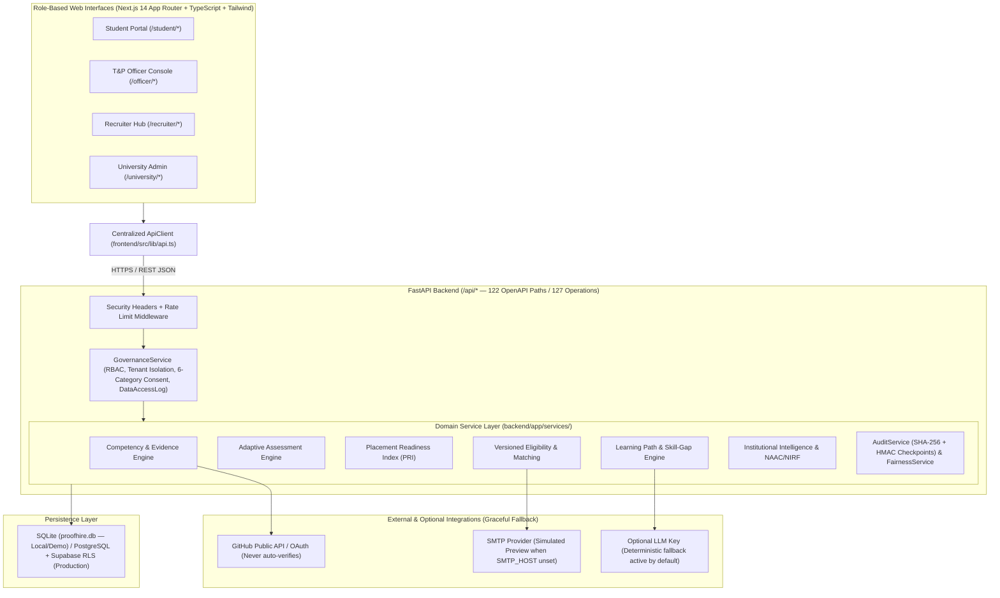

# ProofHire 2.0 — Technical Architecture

## 1. Implemented System Diagram

## 2. Actual Communication & Data Flow
- **Frontend -> Backend:** Every page calls `ApiClient` (`frontend/src/lib/api.ts`), which communicates with FastAPI routers registered under `/api/*`.
- **Governance Gate:** `GovernanceService.authorize_and_log_access()` checks college tenant boundaries, student ownership, recruiter least-privilege, and purpose-specific consent before allowing protected reads/writes, logging to `DataAccessLog` and `SecurityEvent`.
- **Database:** SQLAlchemy ORM supports zero-config SQLite (`proofhire.db`) locally and PostgreSQL/Supabase (`DATABASE_URL`, `db/schema.sql` with `tenant_isolation` RLS policies) in staging/production.
- **External Services Status:** Public GitHub API works when reachable with demo repo fallback; SMTP and external LLM keys are optional—deterministic fallbacks and `simulated_preview` modes ensure full offline/demo reliability without fabricated success claims.
